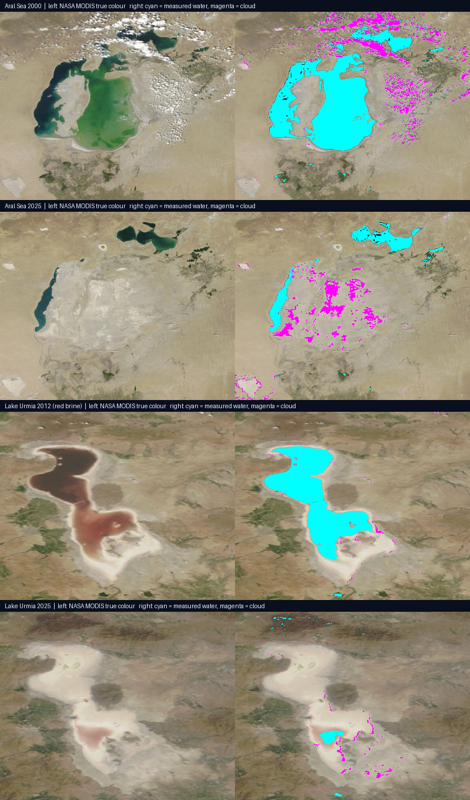

# 🕵️ Earth Detective

NASA Space Apps 2026 · challenge **"Be An Earth System Trend Detective!"**

Pick a place (Aral Sea, Lake Urmia or Lake Mead) and a NASA variable, press **Run Detective Scan**, and the app shows **what** is changing, **where**, **by how much** and **whether the change is statistically significant**.

- **Water area**, measured by us from a real NASA MODIS Terra image for every year since 2000.
- **12 climate variables** from NASA POWER (MERRA-2 reanalysis and CERES/GEWEX satellite data): temperature, rainfall, soil wetness, humidity, snow depth, cloud, radiation and more.
- Every trend gets a **Mann-Kendall test** (p-value: is it real or random?) and a **Sen's slope** (how much per decade). Monthly climate data uses the seasonal Mann-Kendall test, so the yearly cycle doesn't fake a trend.
- **Where:** a 4 × 4 trend map over the place, with significant cells outlined.
- **Time Machine** swipe (2000 vs today), a year slider, and a feed with **live NASA EONET** natural events and a Solutions box.

> Team docs: [`docs/team/00-shared-contract.md`](docs/team/00-shared-contract.md) (read first) and the per-role task files.

## Run it locally (one command)

Plain HTML/CSS/JavaScript frontend + Python (FastAPI) backend. Needs Python 3.10+ and internet (NASA APIs, no keys).

```bash
cd backend
pip install -r requirements.txt
uvicorn main:app --port 8000
```

Open **http://localhost:8000**. API docs are at http://localhost:8000/docs. Offline tests: `python test_backend.py`.

UI-only demo without the backend: open `http://localhost:8000/?mock=1` (uses `frontend/mock/scan-aral.json`, made-up numbers, clearly labelled MOCK). The original in-browser P1 scan test bench is at `/dev/p1-test.html`.

### Layout

| Path | What it does |
|---|---|
| `backend/main.py` | FastAPI app: `/api/scan/{case}` (water scan), `/api/trend`, `/api/trend/grid`, `/api/compare`, `/api/timeseries` (NASA POWER), `/api/events` (EONET), `/api/cases`, `/api/variables`. Serves `frontend/`. Caches NASA responses in `backend/cache/`. |
| `backend/trends.py` | Mann-Kendall (plain and seasonal) and Sen's slope, no heavy dependencies |
| `backend/test_backend.py` | Offline tests with synthetic data |
| `frontend/index.html`, `css/style.css`, `js/app.js` | The app: place + variable picker, case log, significance card, Chart.js trend chart, trend map, Time Machine, feed, Solutions |
| `frontend/js/{cases,nasa,measure,scan}.js` | P1's original in-browser scan engine (same rules as the Python scan) |

### Results from a live run (15 Nov 2026)

| Place | Water, first → latest | Change | Mann-Kendall p | Sen's slope |
|---|---|---|---|---|
| Aral Sea | 13.5% (2000) → 2.4% (2026) | −82% | < 0.001 ✅ | −3.7 pts/decade |
| Lake Urmia | 24% (2000) → 8.6% (2026) | −64% | < 0.001 ✅ | −9.0 pts/decade |
| Lake Mead | 3.5% (2000) → 2.7% (2026) | −23% | 0.001 ✅ | −0.6 pts/decade |

Climate examples (NASA POWER, 2000–2025, seasonal Mann-Kendall): air temperature at Lake Mead is rising about **+0.42 °C per decade** (p = 0.001, all 16 map cells significant) and at Lake Urmia about **+0.40 °C per decade** (p < 0.001). At the Aral Sea centre, temperature shows **no significant trend** (p = 0.94). We show that too.

<!-- P3: app overview, demo link, screenshots, team, "Use of AI" statement go here. -->

---

## How the scan works

### Data

The Python backend (`backend/main.py`, `measure_water`) runs the scan. It uses the same rules as P1's `frontend/js/measure.js`.

- **NASA Worldview Snapshot API** (`wvs.earthdata.nasa.gov`). No key needed.
- **MODIS Terra Corrected Reflectance**, 250 m pixels, two layers per date, same box and size so they line up pixel for pixel:
  - **True colour.** This is what people see in the app (Time Machine, feed).
  - **Bands 7-2-1** (shortwave infrared, near infrared, red). This is what we measure.
- One date per year (**20 August**, late summer and mostly cloud-free) from **2000** (first MODIS Terra year) to the latest year available.

### Method

1. For each year, download both images of the case's bounding box (800 × 640 px, downscaled to 400 px wide for measuring).
2. Classify every pixel:
   - **Water.** In bands 7-2-1, water absorbs shortwave and near infrared, so it is dark: `SWIR < 45`, `NIR < 70`, `blue ≥ SWIR`. We use infrared because in true colour water can look blue, black, algae-green (Aral Sea 2000) or **brine-red** (Lake Urmia 2010–2013). A "looks blue" rule measured Urmia as 0% water in years when it was plainly full.
   - **Cloud.** Bright in all three 7-2-1 bands. Wet salt flats are cyan in 7-2-1 (low SWIR), so they are *not* mistaken for cloud.
   - **No data.** Pure black in true colour (MODIS swath gaps).
3. **Water %** = water pixels ÷ pixels with data × 100. It is a share of the image box, not km².
4. The trend is the year-by-year water %. We report the change from the first to the latest measured year, the **biggest single drop** between two neighbouring measured years, and a **Mann-Kendall test** (p < 0.05 = significant) with **Sen's slope** in percentage points of the image per decade. Gap years are left out of the test, never filled.

The thresholds were tuned by eye on real images. `frontend/assets/debug-mask.png` shows the true-colour image next to the measured water (cyan) and cloud (magenta) for Aral Sea 2000/2025 and Lake Urmia 2012/2025.



### Quality checks

- A date is **rejected** if more than 30% of the image is cloud, more than 20% has no data, or the scene is **hazy**. A scene counts as hazy when even its darkest 0.3% of pixels are not dark in shortwave infrared, which happens when thin cloud or smoke covers everything (Lake Mead, 20 Aug 2026).
- If the date is rejected or has more than 10% cloud, we also try **+7 days** and **−7 days** and keep the clearest valid image.
- If none of the three dates works, the year is marked `cloudy` or `failed` with `waterPct: null` and drawn as a **gap**. We never fill it with a guess.
- Every measured year has `estimated: false`. The only estimated numbers are in `mock/scan-aral.json`, which is mock data for building the UI and is labelled as such.

### Results from a test run (15 Nov 2026)

| Place | First → latest measured | Change | Biggest single drop | Years measured |
|---|---|---|---|---|
| Aral Sea | 13.6% (2000) → 2.5% (2026) | **−82%** | 2008 → 2009 | 27 / 27 |
| Lake Urmia | 24.0% (2000) → 8.6% (2026) | **−64%** | 2021 → 2022 | 27 / 27 |
| Lake Mead | 3.6% (2000) → 2.8% (2026) | **−22%** | 2013 → 2014 | 27 / 27 |

Re-running can change these numbers slightly, because a different retry date may be picked.

### Sanity check against NASA

- **Aral Sea.** NASA Earth Observatory's *World of Change: Shrinking Aral Sea* ([earthobservatory.nasa.gov/world-of-change/AralSea](https://earthobservatory.nasa.gov/world-of-change/AralSea)) shows the eastern basin almost gone by 2014 and only the North Aral and a thin western strip left. **Our trend agrees:** a steady fall from 2000, the 2009 low when the eastern basin nearly dried, and about 2–3% of the box left today.
- **Lake Urmia.** It is widely reported to have lost most of its surface by the mid-2010s, with a partial recovery after the wet years of 2019–2020. **Our trend shows the same shape:** a fall to about 3% in 2014–2015, a rise to about 16% in 2019–2020, then a collapse again in 2022–2025.
- **Lake Mead.** Earth Observatory's *World of Change: Lake Mead* ([earthobservatory.nasa.gov/world-of-change/LakeMead](https://earthobservatory.nasa.gov/world-of-change/LakeMead)) shows a large drop in water level. **Our signal is weak and noisy** (−22%). The lake is a narrow canyon only a few 250 m pixels wide, so a level drop of tens of metres removes few pixels. This is our weakest case. Treat it as a demo of the method's limits, not a strong finding.

### Limits (please read)

- **250 m pixels.** Narrow lakes and rivers (Lake Mead) are only a few pixels wide, so small errors become big percentages.
- **One date per year.** It misses seasonal change; a wet spring and a dry August can look very different.
- **Share of the box, not area.** Water % depends on how the bounding box is drawn. Compare years of the same place, not different places.
- **Clouds, haze and smoke** can hide water. We reject the worst images, but thin cloud over the lake itself can still lower one year's number.
- **Shallow, salty or muddy water** and wet salt flats sit on the edge of the threshold. They may be counted as land (Aral Sea's shallow southern edges) or, rarely, as water.
- **Cloud shadows and dark terrain** can occasionally be counted as water.
- The thresholds were tuned by eye on a handful of images, not validated against ground truth.

### Code

| File | What it does |
|---|---|
| `js/cases.js` | The case-study places (bounding box + date) |
| `js/nasa.js` | `snapshotUrl()`, `loadImage()` (CORS, 20 s timeout), `fetchEvents()` (NASA EONET live events) |
| `js/measure.js` | `measureWater(trueImg, irImg)` → `{ waterPct, cloudPct, noDataPct, hazy, valid }`, plus `debugMask()` |
| `js/scan.js` | `runScan(caseId, { rescan })` → `ScanResult`; fires `scan:log`, `scan:done`, `scan:error`; renders the terminal into `#terminal`; caches in `sessionStorage` |
| `mock/scan-aral.json` | **Mock** `ScanResult` (made-up numbers, all `estimated: true`) for UI work |
| `dev/p1-test.html` | P1 test bench: run scans, view the table, debug masks, EONET list |

Each year in a `ScanResult` also carries `analysisUrl` (the 7-2-1 image) and `cloudPct`, in addition to the contract fields.
